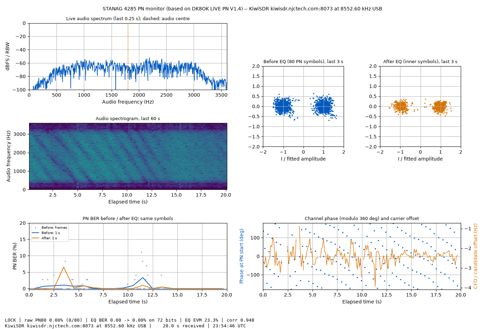

# LIVE PN in Python: STANAG 4285 sync and equalizer monitor

This is a Python version of **DK8OK's STANAG4285 LIVE PN V1.4** (MATLAB, © 2026 Nils Schiffhauer, DK8OK), published
with his permission. LIVE PN finds the 80-symbol PN sync sequence in each 106.7-ms frame of a STANAG 4285 signal. For
every frame it measures:

- the PN bit error rate,
- the carrier offset,
- the channel phase,
- the error-vector magnitude,

and runs a small equalizer, trained on the previous frame, to show how much it repairs.

The signal processing and every default follow his program, setting for setting. Anything we added is a named
option, and all of those are off by default.

| | |
|---|---|
|  | The live window, showing FUF (French Navy, Martinique, 8552.6 kHz USB) received through a public KiwiSDR in Sutton, MA, on 13 October 2026. |

The programs are in `livepn/`. Except for the one-time package installation (section 1), all commands are run in
this folder (`code/stanag4285-livepn`).

---

## 1. Install (once)

**The short way: ask an AI assistant.** If you use an AI assistant that can work with the files and run commands on
your computer (a coding assistant or an agent, not just a chat window), it can do the whole set-up for you. Point it
at this folder and say something like:

> Please read the README in this folder and get the program running on this computer: install Python if it is
> missing, install the packages, and run the checks in section 1. Then run the comparison in section 2 on my files
> DK8OK_LIVE_PN.csv and DK8OK_LIVE_PN_INPUT.wav, and explain the result to me.

It should need only the steps written below; it should not need to change the program itself. If it proposes edits
to the code, treat that as a sign that something is wrong, and please tell us (see section 2). Watch what it does,
as you would with any helper on your computer.

**The step-by-step way.** You need Python 3 (tested with 3.12) and three common packages: numpy, scipy and
matplotlib.

**Windows: getting Python.** Windows doesn't include Python. Typing `python` on a fresh system only opens a
Microsoft Store page, and MATLAB doesn't come with one. Install it once, in any of these ways:

- **python.org (the usual choice):** download the Windows installer from https://www.python.org/downloads/ and run
  it. On its first screen, tick **"Add python.exe to PATH"**. This also installs the `py` launcher.
- **Microsoft Store:** search for "Python 3.12" and click Install.
- **Command line:** `winget install Python.Python.3.12`

Then open a new Command Prompt window and check with `python --version` (or `py --version`). The commands in this
README are typed there, in a Command Prompt (or PowerShell, or a macOS/Linux terminal), not in MATLAB's Command
Window.

**Get the files.** On the repository's main page, choose *Code → Download ZIP* and unpack it, or
`git clone https://github.com/Mike-quantum/ab1ld-hf-notes`.

**Install the packages and check, step by step.** On Windows: open the unpacked folder `ab1ld-hf-notes` in File
Explorer, click in the address bar, type `cmd` and press Enter. A Command Prompt opens in that folder. Then type
these lines one at a time (use `py` instead of `python` if `python` isn't found):

```
python -m pip install -r requirements.txt
cd code\stanag4285-livepn
python livepn\test_livepn.py
python livepn\try_demo.py
```

The first installs numpy, scipy and matplotlib (once). The test takes a minute or two and ends with
"18 tests, 0 failed". The demo runs DK8OK's own demo signal (+7 Hz, slowly turning phase) and prints how well it is
measured. On macOS and Linux, type the same lines with `/` instead of `\`, and `python3` if `python` isn't found.
The rest of this README writes paths with `/`; on Windows either works for these programs.

## 2. Comparing it with DK8OK's MATLAB program

If you have LIVE PN V1.4 in MATLAB, you can check this version against it on exactly the same audio.

1. **In MATLAB**, run LIVE PN on a STANAG 4285 signal as usual. Press **Stop** about 1½ minutes after Start
   (anywhere between 1 min 15 s and 1 min 55 s), then **Save CSV** (`DK8OK_LIVE_PN.csv`) and **Save WAV**
   (`DK8OK_LIVE_PN_INPUT.wav`, the last 10 s of audio it analysed). Save both right after Stop, so the WAV is the
   end of the run the CSV describes. The timing matters because LIVE PN renews its recorder after each minute of
   audio; stopping well into the second minute keeps a renewal out of the saved 10 s. (The script warns if one is
   there.)
2. **Put the two files in this folder** (`code/stanag4285-livepn`), or type their full paths in quotes in the
   commands below, e.g. `"C:\Users\Nils\Documents\DK8OK_LIVE_PN_INPUT.wav"`.
3. **In Python**, analyse the WAV:
   ```
   python livepn/livepn_offline.py DK8OK_LIVE_PN_INPUT.wav
   ```
   This writes `DK8OK_LIVE_PN_INPUT_DK8OK_LIVE_PN.csv`, with the same columns as the MATLAB file, plus the plots.
4. **Compare the two files:**
   ```
   python livepn/compare_with_matlab.py DK8OK_LIVE_PN.csv DK8OK_LIVE_PN_INPUT_DK8OK_LIVE_PN.csv
   ```

### What the comparison script does

The MATLAB CSV covers the whole run, but the WAV covers only its last 10 s. The script works out where the WAV
starts within the run, using two facts:

- **The WAV is the end of the run.** Only start times that put the last frames of the two files close together
  are considered.
- **Frames come every 106.7 ms, so timing alone can't settle it.** Start times one or more frames apart line the
  frames up equally well. Among them, the script takes the one where the measured values agree best, relative to
  how much they normally change from frame to frame. The carrier offset usually decides it.

On a very steady signal every frame looks alike, and the script says **AMBIGUOUS** and lists the candidates. The
agreement figures are still meaningful then, because neighbouring frames carry nearly the same values.
`--offset SECONDS` sets the start time yourself.

It then pairs the locked frames the two programs measured at the same moment. For each column it reports how many
pairs agree, the median and largest difference, and the first pairs side by side.

### What to expect

The two programs see the same audio, but they don't cut it into the same analysis windows. The MATLAB timer
delivers audio about every 0.2 s plus whatever its own processing takes; the Python version uses exact 0.2-s pieces.
Where a window starts shifts V1.4's resampled sample grid by a fraction of a sample. So the same frame measured from
two different windows comes out slightly different, whichever program measures it. Running our own program twice
on the same audio, cut into different pieces, gave:

- **carrier offset:** typically 0.01–0.02 Hz apart, at most about 0.13 Hz;
- **correlation:** about 0.001 apart;
- **EVM:** up to a few hundredths apart;
- **bit error rates:** identical.

The script counts a pair as agreeing within those amounts (0.2 Hz, 0.01, 0.05) and requires the bit error rates to
be identical. In addition:

- **A few frames may differ more.** These are frames close to the 0.48 lock threshold, which one program may lock
  and the other not, and frames under strong multipath, where the carrier-offset fit is sensitive (see section 6).
- **The first frame or two of the WAV may differ.** The equalizer needs the frame before, and the WAV has no audio
  before its start.
- **The fitted phase will differ by a constant.** Each program measures phase from its own time origin. The script
  removes that constant before comparing.

The script was checked on simulated runs. Our own program stood in for MATLAB, fed in irregular 0.20–0.28-s pieces
the way his timer delivers audio, and its last 10 s were analysed separately. On a noisy two-path signal it found
the WAV's start exactly every time and the values agreed as listed above. On a perfectly clean, steady signal it
reported AMBIGUOUS, correctly. With a recorder renewal inside the saved 10 s, it warned. Those checks show the
comparison tool works, but they say nothing yet about MATLAB vs Python: that needs a real MATLAB run. Results are
welcome as an [Issue](https://github.com/Mike-quantum/ab1ld-hf-notes/issues) or in the Dopplergram group.

## 3. Analysing a recording: `livepn_offline.py`

The input is USB audio with the 4285 signal centred near 1800 Hz (`--centre` to change):

```
python livepn/livepn_offline.py recording.wav
python livepn/livepn_offline.py recording.wav --start-utc 2026-10-10T10:40:00 --note "FUF 8552.6"
```

To try it on the FUF recording in this repository, first turn the I/Q recording into USB audio (I/Q centre
8554.4 kHz, USB carrier 8552.6 kHz), then analyse it:

```
python livepn/iq_to_usb_audio.py ../../data/2026-10-01_FUF_8552.6kHz/FUF_8552.6kHzUSB_IQcentre8554.4kHz_20261001T105500Z_12000Hz_iq.wav 8554.4 8552.6 FUF8552.6_usb_20261001T105500Z.wav
python livepn/livepn_offline.py FUF8552.6_usb_20261001T105500Z.wav --out results
```

The output is DK8OK's two CSV files (`..._DK8OK_LIVE_PN.csv` and `..._ARCHIVE.csv`, with his column names) and three
pictures:

| File | What it shows |
|---|---|
| `_overview.png` | Constellations before and after the equalizer, BER before and after, phase and carrier offset, spectrogram (his Live PN / Equalizer tab, for the whole file) |
| `_archive.png` | His Time archive tab |
| `_bits.png` | His PN bit comparison tab |

If the file name contains a time such as `20261001T105500Z`, the UTC column is filled in automatically.

## 4. Watching live: `livepn_live.py`

The window (pictured above) follows his Live PN / Equalizer tab:

- audio spectrum with the centre line,
- 60-s spectrogram,
- PN80 constellation before the equalizer and symbols after it (last 3 s),
- PN BER before and after the equalizer,
- channel phase and carrier offset,
- his status line.

It takes its signal from a file or from a KiwiSDR on the network, so there's **no sound card or virtual audio cable
to set up**:

```
python livepn/livepn_live.py --iq ../../data/2026-10-01_FUF_8552.6kHz/FUF_8552.6kHzUSB_IQcentre8554.4kHz_20261001T105500Z_12000Hz_iq.wav --iq-centre 8554.4 --dial 8552.6 --loop
python livepn/livepn_live.py --replay usb_audio.wav --loop
python livepn/livepn_live.py --kiwi HOST:8073 --dial 8552.6 --user YOURCALL
```

- **`--iq`** takes an I/Q recording and does the USB demodulation itself:
  - It accepts a plain 2-channel WAV or a KiwiSDR (kiwirecorder) file. Reading a Kiwi file leaves a small index
    file (`.idx256.npz`) next to it, which speeds up the next reading.
  - `--dial` is the station's USB dial frequency. `--iq-centre` is the recording's centre frequency. It can be left
    out for a Kiwi file that still has kiwirecorder's original name (`YYYYMMDDTHHMMSSZ_<centre in Hz>_...`), which
    carries it.
  - If a Kiwi file has a gap (missing GPS-stamped records), a note is printed. The audio is joined across the gap,
    so frame times after it are early by the length of the gap.
- **`--replay`** plays a USB-audio WAV at real time (`--speed 4` for four times faster).
- **`--kiwi`** listens to a KiwiSDR live. See below.
- **`--save FOLDER`** writes the two CSV files when the run ends: when you close the window, when a Kiwi stream
  ends (owners' time limits end sessions this way), or on Ctrl-C. For a Kiwi the file names carry the host, port,
  frequency and start time, e.g. `kiwi_kiwisdr-example-com_8073_8552p60kHz_20261013T235400Z_live_DK8OK_LIVE_PN.csv`.
  The live audio itself is not saved.
- **`--note "text"`** fills the Note column.
- **His settings are options:** `--centre`, `--taps`, `--ridge`, `--no-eq` and `--hold`.

### Live KiwiSDR

Live KiwiSDR needs John Seamons's `kiwirecorder.py`. Get it once, into this folder (`code/stanag4285-livepn`):

```
git clone https://github.com/jks-prv/kiwiclient
```

Or download the ZIP from that page and unpack it here as `kiwiclient`. You can also point to it with
`--kiwiclient DIR`.

To find a Kiwi, use the public list at https://kiwisdr.com/public or the map at http://rx.linkfanel.net. The
program checks the Kiwi's status page before connecting, and politely stops with a plain message in these cases:

- the owner allows no scripted connections,
- it is full,
- only its last free channel is left (`--allow-last-channel` overrides this, for your own Kiwi).

It shows `--user` in the Kiwi's user list. Please use your call, and keep sessions short on other people's
receivers.

## 5. What is the same as V1.4, and what is different

**The same (defaults unchanged):**

- the signal path: Hilbert transform and mixer, 19.2 kS/s, RRC filter;
- the ±450 Hz × 8-phase PN80 search with its one-frame-later check, and the 0.48 lock gate;
- the per-frame carrier-offset and phase fit, PN BER and EVM;
- the ridge FIR equalizer trained on the previous frame (9 taps, ridge 0.02);
- the scheduling thresholds: 0.85-s window, 0.65-s minimum interval, 0.4-s first analysis, 2.5-s buffer;
- the 1-s archive and the CSV columns. The file names are his default names prefixed with the recording's name,
  e.g. `recording_DK8OK_LIVE_PN.csv`.

**Different:**

- **Input** comes from files or a KiwiSDR, not a sound card. There is no device menu and no Save WAV: a recording is
  already a file, and live Kiwi audio is not saved.
- **Audio pieces.** The audio is fed in exact 0.2-s pieces. His timer delivers audio about every 0.2 s plus the time
  its own processing takes, so his analysis windows fall a little differently (see section 2, "What to expect").
- **Settings** are command-line options rather than controls in the window.
- **Archive and bit comparison** are pictures from `livepn_offline.py`, not live tabs. The live window shows the
  Live PN / Equalizer tab.
- **Kiwi timing.** A Kiwi delivers about 11999 samples/s. That is treated as 12000 and the audio centre is scaled to
  match, so the signal is found at the right frequency. Two small effects remain:
  - after a true hour, the elapsed-time column reads 3599.7 s;
  - carrier offsets come out 12000/11999 times the true value, under 0.01 Hz at the usual offsets.
- **Live display.** The live window leaves out his SILENCE / CLIPPING labels and audio-level readout.
- **Archive quirk, kept from V1.4.** After a failed acquisition, a frame measured just before it can be missing from
  the 1-s archive (never from the frame CSV). This matches his code, so it is not changed.

## 6. Two things we noticed in V1.4 (both easy to check with this program)

- **One frame in 15 can go unmeasured.** With exact 0.2-s pieces, an analysis runs every 0.8 s, but a 0.85-s window
  only fully contains frames spanning about 0.79 s. On some signals this leaves an 8-ms gap between windows, so a
  frame that starts there is never measured. In his program the gap depends on the computer: with pieces of 0.22 to
  0.26 s, three pieces fit the threshold without a gap; with shorter or longer pieces there is one. The option
  **`--complete`** (minimum interval 0.5 s) closes the gap. As in V1.4, the last fraction of a second of a
  recording, after the last analysis, is not measured.
- **The carrier-offset fit is fragile under strong multipath.** The per-frame offset comes from a straight line
  fitted to the unwrapped phase of the 80 PN symbols. When inter-symbol interference makes some of those phases
  jump, the unwrapping goes wrong and the frame is rejected or gets a wild offset. The option **`--cfo-guard`**
  (ours, off by default) checks each fitted offset against the acquisition offset. If the fit makes the PN match
  worse, it uses a direct (periodogram) estimate instead.

  On the 10-min FUF recording in this repository (section 3), 4394 of 5623 frames lock with DK8OK's settings, and
  5500 of 5623 with `--cfo-guard`.

## 7. Files

| File (in `livepn/`) | What it is |
|---|---|
| `s4285_livepn.py` | The analyser: his signal path, scheduling, equalizer and logs |
| `s4285_reference.py` | Constants, his PN31 generator, PN80, RRC filter |
| `s4285_sources.py` | File, I/Q and KiwiSDR sources; USB demodulation from I/Q |
| `livepn_offline.py` | WAV in, his CSV files and pictures out |
| `livepn_live.py` | The live window |
| `compare_with_matlab.py` | MATLAB CSV vs Python CSV (section 2) |
| `iq_to_usb_audio.py` | Turns an I/Q recording into a 48-kHz USB-audio WAV |
| `s4285_testsignals.py` | His demo signal, and an independent STANAG 4285 test signal with multipath |
| `test_livepn.py`, `try_demo.py` | Checks, and the demo |

KiwiSDR recordings are read with `code/kiwi-tools/kiwiwav.py`, which is elsewhere in this repository.

## Credits

- **LIVE PN V1.4 and its methods:** Nils Schiffhauer, DK8OK (© 2026). He posted it to the Dopplergram group on
  11 October 2026 ("STANAG4285: P/N Sequence and Equalizer"), saying there that he wrote it with the help of
  ChatGPT. The program's own header cites STANAG 4285 Annex A (Fig. A-4) and MathWorks' audio functions. His
  STANAG 4285 work, as he credits it in the documentation of his earlier ESSENTIAL app, grew from Con Wassilieff,
  ZL2AFP ("STANAG 4285 Receiver"), with suggestions from Peter Martinez, G3PLX.
- **Permission:** his statement of 7 October 2026 about his STANAG 4285 software, "Please feel free to use, improve,
  change and share my software", and his post of 9 October inviting a version more widely used by the community.
  The Python version is offered back to him. Where each part of his program went is listed in `CREDITS.md`.
- **kiwiclient / kiwirecorder:** John Seamons (jks-prv), not included; fetched separately.
- **Public KiwiSDR list:** kiwisdr.com; map by Pierre Ynard (rx.linkfanel.net).
- **Reviews before publication:**
  - GPT-6 Astra (OpenAI) and Claude Fable (Anthropic) reviewed the code against the MATLAB original on 13 October
    2026.
  - Their findings led to the fixes of 14 October: the comparison script's start-time search and tolerances, KiwiSDR
    start-up and shutdown, saving when a stream ends, and the README's Windows steps.
  - The reviews and our response are kept with the author's notes.
- **Python version:** Mike Burns, AB1LD, with Claude (Anthropic), October 2026.
